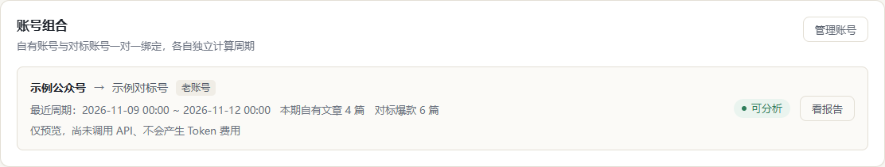
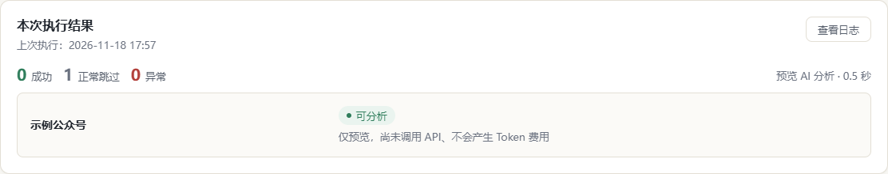
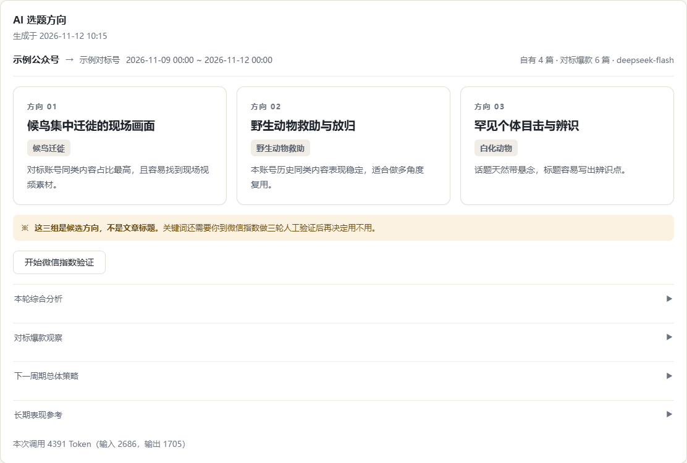
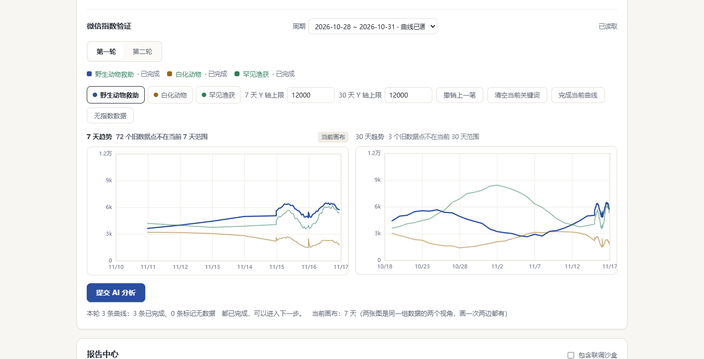

# 公众号爆款选题系统 · WeChat Topic Studio

> 输入你自己账号与对标账号的真实文章数据，输出「每期 3 组选题方向 → 两轮微信指数验证 → 最多 3 个可以直接写的标题」。
>
> A local, self-hosted topic-research workbench for WeChat public accounts. It reads article data you already collected locally, asks DeepSeek for topic directions, and narrows them down to at most 3 ready-to-write titles through two rounds of user-drawn interest-curve validation plus web-verified event deduplication.

**它不做的事情（很重要）**：不抓取微信文章、不读取微信指数、不写文章、不发布、不自动定时调用 API。所有外发请求只有两个：DeepSeek（生成）和博查/Tavily（联网检索）。

## 操作流程（截图）

四步，前两步免费：

**① 数据接进来了**：账号组合显示最近周期与文章数，状态「可分析」


**② 预览**：告诉你这一期能不能分析、会花多少 token —— 不调用模型、不花钱


**③ 三组选题方向**：每组带关键词与推荐依据，点一次才真正扣费


**④ 微信指数两轮验证**：手绘 7 天/30 天趋势，第二轮联网核实后给出最多 3 个可写标题


（截图用示例账号数据生成，不含任何真实账号信息。）

---

## 它解决什么问题

公众号选题最大的浪费是「凭感觉定方向，写完才发现没人关心」。这个工具把选题拆成三步，每一步都能看见依据：

1. **给方向** —— 用你账号最近三个月的真实表现 + 对标账号同期表现，让模型给 3 组选题方向（每组带关键词与推荐依据）。
2. **验热度** —— 你把微信指数里看到的热度曲线**手绘**进网页（7 天 / 30 天两个视角），系统据此让模型深挖 3 个新关键词。
3. **找事件** —— 第二轮再画一次曲线，系统联网检索真实新闻、核对原文、按**事件**去重，最后给出最多 3 个可以直接动笔的标题，且每个标题都附来源链接。

最终产物是标题 + 事件要点 + 来源，不是文章。

## 成本

一期完整链路（基础方向 + 第一轮 + 第二轮，共 6 次联网搜索）：

| 项目 | 实测 |
|---|---|
| 模型 token（deepseek-flash） | 约 0.037 元 |
| 联网搜索（博查 0.036 元/次 × 6） | 约 0.216 元 |
| **合计** | **约 0.25 元 / 期**（高峰时段约 0.29 元） |

搜索费占了 85%，模型很便宜。博查有 1000 次免费试用额度，用完之前实际只有几分钱。

## 环境

- Windows 10/11（`.bat` 启动脚本是 Windows 的；Python 部分是跨平台的，也可以直接命令行跑）
- Python 3.13（3.11+ 应该都能跑，未逐一验证）
- 一个 DeepSeek API Key
- 一个博查（Bocha）或 Tavily 的搜索 API Key

## 安装

```powershell
git clone <本仓库地址> wechat-xuanti
cd wechat-xuanti

python -m venv .venv
.\.venv\Scripts\python.exe -m pip install -r requirements.txt
```

> 注意：`.bat` 脚本要求 `.bat` 文件是 **CRLF + 纯 ASCII**，中文提示一律交给 Python 打印。改脚本时别用会转成 LF 的编辑器保存。

## 配置

复制 `.env.example` 为 `.env`，填两个 Key：

```ini
DEEPSEEK_API_KEY=你的key
SEARCH_PROVIDER=bocha          # 或 tavily
BOCHA_API_KEY=你的key
TAVILY_API_KEY=
```

`.env` 已在 `.gitignore` 里，**不要提交**。程序只从 `.env` 读密钥，不读环境变量、不写日志。

然后准备账号组合（自有账号 ↔ 对标账号），在网页上填也可以，或直接编辑 `ai_pairs.json`：

```json
{
  "pairs": [
    { "own_account": "你的公众号", "benchmark_account": "对标公众号", "account_type": "old", "enabled": true }
  ]
}
```

## 运行

```powershell
# 方式一：黑窗口 + 手动开浏览器（推荐，最省事）
双击 启动系统-浏览器版.bat

# 方式二：命令行
.\.venv\Scripts\python.exe web_app.py
```

服务默认监听 `127.0.0.1:8765`；端口被占会自动往上找空闲端口，控制台会打印实际地址。

**数据放在哪**

```
公众号分析输出/AI选题报告/<账号>/<周期>/分析结果.json     基础选题方向
公众号分析输出/微信指数验证/<账号>/<周期>/task.json      两轮验证任务（含手绘曲线）
公众号分析输出/选题去重库/<账号>.xlsx                    按事件去重的历史库
公众号分析输出/账号定位/<账号>.md                        每两个完整周期更新一次
```

`storages/` 是你自己采集的文章原始数据（本仓库不带，需要你自己准备采集工具）。

## 两个关键设计（用之前值得知道）

- **7 天 / 30 天是「一条曲线、两个视角」**：同一份按绝对时间戳存的数据，两张图只是时间窗口不同。画 7 天，30 天自动压缩显示在右侧 1/7；不重复画、不存两份。
- **手绘数值是你目测估算，不是微信指数官方数据**。界面和喂给模型的材料里都明确写了这一点，不要让模型把它当成真实指标。

更多设计取舍见 [docs/design.md](docs/design.md)。

## 完整流程（含文章采集）

本仓库只负责「拿到文章之后」的分析。文章要从微信公众号采集，采集器不在本仓库，但有一条龙脚本：

1. **装采集端**：双击 `安装采集端.bat` —— 自动下载到 `collector/`、装依赖、把数据目录接到本项目
2. **采集文章**：`cd collector` 然后 `uv run python main.py`，按采集器界面操作
3. **跑选题**：双击 `启动系统-浏览器版.bat`，点「更新本地数据」→ 预览 → 开始 AI 分析

采集器是上游项目（CC BY-NC-SA 4.0，不可商用），本项目是 MIT，所以**代码不复制、只帮你装**。详细步骤和常见问题见 [docs/collector.md](docs/collector.md)。

## 部署

本项目是本地自托管的，没有官方托管站点：每位使用者在自己的电脑或服务器上运行一份。完整说明见 [docs/deploy.md](docs/deploy.md)，一句话版本：

**Windows 用户**：装好 Python 后双击 `安装.bat`，它会建环境、装依赖、生成 `.env`、启动。

**有 Docker 的机器**（Windows / macOS / Linux / NAS）：

```bash
docker run -d -p 127.0.0.1:8767:8767 \
  -e DEEPSEEK_API_KEY=你的key -e SEARCH_PROVIDER=bocha -e BOCHA_API_KEY=你的key \
  -e XUANTI_ACCESS_TOKEN=自己定一个口令 \
  -v xuanti-data:/app/公众号分析输出 \
  ghcr.io/barnesjamesl2gv1-ai/wechat-xuanti:latest
```

> ⚠️ 只要不是「只给自己本机看」，就必须设 `XUANTI_ACCESS_TOKEN`。这个工具没有登录体系，不设口令等于把 API 额度公开给能访问到端口的人。设了口令后，第一次打开 `/auth?token=口令` 换 cookie。

**也可以让 AI agent 完成部署。** 把下面这段话整段发给本机能执行命令的 agent（Claude Code / Codex / Cursor 等）：

```text
帮我把 https://github.com/barnesjamesl2gv1-ai/wechat-xuanti 部署到我这台电脑：
用 uv（没有 uv 就用 Python 3.11+ 的 venv）建环境、装依赖、启动服务，
最后把访问地址告诉我。部署前先检查 Python/uv 是否存在，缺什么先告诉我。
API Key 我自己填 .env，不要让我在对话里贴出来。
```

agent 会 clone、建环境、装依赖、复制出 `.env`，停在填 Key 这一步，最后报出访问地址。前提只有两个：机器上有 Python 3.11+（或 uv/Docker），以及能连 PyPI。

## 测试

```powershell
.\.venv\Scripts\python.exe -m unittest test_wechat_index_dedup test_web_app_status test_web_app_auth -v
```

三组都是**离线**用例，不联网、不调模型、不碰真实数据：

- `test_wechat_index_dedup`：事件去重是这个系统里唯一「错了也看不出来」的地方，所以专门钉住了口径（换说法判重、同地区不同事件不误伤、同批次多角度保留等）；
- `test_web_app_status`：`/api/status` 的返回值必须能被 jsonify 直接序列化——这里曾经混进过 `Path` 对象，导致正式作用域第一次出现 AI 结果时接口 500，而沙盒数据恰好被跳过，所以藏了很久。

## 常见问题

| 现象 | 原因 / 处理 |
|---|---|
| 改了 `templates/index.html` 不生效 | Flask 未开 debug，模板有缓存，**重启服务** |
| 页面被别的程序占了 | 端口被其他程序占用，程序会自动换端口，看控制台打印的地址 |
| `.bat` 双击闪退 | 检查文件是否被存成了 LF 换行或含中文 |
| 第二轮报「输出被截断」 | 思考型模型的 reasoning 会把 token 吃满，已把上限提到 8000；如仍出现请提 issue |
| 提交按钮一直灰着 | 每条曲线都要点「完成当前曲线」或标记「无指数数据」 |

## 提交前自检（建议开启）

仓库带了一个提交前钩子，扫描**本次暂存的内容**里有没有：邮箱、本机绝对路径、手机号、`sk-` 类密钥、私钥文件。命中就拦下提交，不会碰到历史提交。

```powershell
git config core.hooksPath .githooks                              # 每份克隆执行一次
git config --local leakguard.words "你的公众号名,对标账号名"      # 只想保护的真实名称
```

- 第二行把真实账号名放进**本地** `.git/config`——它不会被提交，写进仓库反而是另一次泄露。
- 纯本地运行、不联网，只检查暂存区。
- 遇到误报：在该行加注释标记 `leakguard:allow`。
- 临时跳过：`git commit --no-verify`。
- 手动全量扫一遍：`.\.venv\Scripts\python.exe scripts/check_leaks.py`

## 许可证

MIT，见 [LICENSE](LICENSE)。

**致谢与边界**：本项目在早期参考过 [yeximm/Access_wechat_article](https://github.com/yeximm/Access_wechat_article)（MITMProxy 桌面采集外壳，CC BY-NC-SA 4.0）的目录约定与数据结构思路；**该上游代码（含其桌面启动器、Vue 界面、字体资源）不包含在本仓库内**，本仓库代码为独立实现，不依赖上游任何模块。如果你需要采集端，请自行前往上游项目并遵守其许可证（含非商业限制）。

微信文章内容版权归原作者所有，本工具只读取你本地已有的数据，不分发、不缓存、不上传任何文章内容。AI 输出仅供参考，请自行核实事实。
